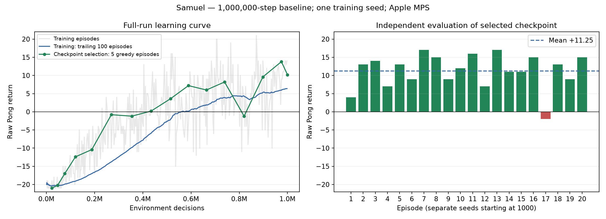

# Deep-Q-Learning

## Project Introduction

## Group Members

- Divine
- Gabriel
- Samuel

## Selected Atari Environment

## DQN Architecture

Samuel's diagram below documents Divine's shared CNN: four 84×84 grayscale
frames pass through three convolutional layers (32, 64, 64 filters), a 512-unit
dense layer and six action Q-values. Pixels are normalized inside the network.
The online and target networks have identical architecture and separate weights.

## Network Architecture Diagram


[Layer shapes and editable Mermaid diagrams](docs/Samuel_architecture.md)

## Training Process

Samuel's `train_step` consumes batches supplied by Gabriel's replay buffer.
It gathers the online value for each sampled action and computes the detached
Bellman target `reward + gamma * (1 - terminated) * max(target(next_state))`.
A Smooth L1 loss is backpropagated through the online network, gradients are
clipped to norm 10, and Adam updates its weights. True termination masks the
bootstrap; time-limit truncation does not.

The shared loop schedules target synchronization every 1,000 decisions. Samuel's
logger records raw episode return, length, cumulative decisions, epsilon and the
latest update loss. Model saving is atomic, honors `--model_path`, and supports
periodic and final saves. His optional full-run utility evaluates snapshots,
retains the highest measured checkpoint, then tests it on separate seeds.

The submission file `dqn_model.pth` is an exact copy of Samuel's selected
`models/Samuel/full_20261113/best.pth` (step 974,891). The actual final million-step
weights remain saved separately. These checkpoints contain inference weights.

## Training Results

Samuel's full baseline completed **1,000,000 decisions**, training every step
on Apple MPS. The selected checkpoint achieved **+11.25 mean raw return**
and won **19 of 20 independent evaluation games**. One game was lost;
this is measured improvement, not a guarantee of perfect play.

[Full report](logs/Samuel/full_20261113/report.md),
[experiment table and pilot results](SamuelHyperparameter_experiment_results.md),
[full-training workflow](docs/Samuel_full_training.md).



The run reached one million steps. Its selected checkpoint is from step
974,891; the best model and the actual final million-step weights are
both retained. Selection used five greedy episodes (seeds 100–104); the reported
independent result uses 20 other episodes (seeds 1000–1019). All completed without
truncation or step caps. See the manifest for the exact settings and source hashes.

The ten earlier 20,000-step pilots and their artifacts remain preserved under
`main_20261113`, with the original pilot also archived. The full baseline is an
additional experiment.

## Gameplay Demonstration

[Winning full-run gameplay (MP4)](videos/Samuel/full_20261113/gameplay.mp4) —
selected model, greedy policy, seed 1000, raw return **+4**.
The complete episode is 223.2 seconds at 15 fps.
[Episode metadata](videos/Samuel/full_20261113/gameplay.json).

## How to Run

```bash
uv sync
uv run train.py --member Samuel --experiment 11
# Presentation: canonical model, greedy actions, live game window:
uv run play.py
# Automated evaluation without a window:
uv run play.py --headless --episodes 5
# A different checkpoint can still be supplied:
uv run play.py models/Samuel/full_20261113/best.pth --render
# Record one complete evaluation episode:
uv run play.py models/Samuel/full_20261113/best.pth --episodes 1 --video videos/Samuel/new_gameplay.mp4
# Run ten experiments in a fresh output folder (main defaults to train_every=1):
uv run run_samuel_experiments.py --run_id full_run_01 --steps 500000
# Short comparison pilot using the previous interval of 4 decisions:
uv run run_samuel_experiments.py --run_id pilot_02 --steps 20000 --train_every 4
uv run summarize_samuel_experiments.py --run_id pilot_02 --record
# Samuel's regression checks:
uv run python -m unittest discover -s tests -v
```

Training logs refuse to overwrite an existing member/experiment CSV. Use a fresh
experiment ID or archive previous artifacts before rerunning. The experiment
runner likewise rejects existing outputs. Save and evaluation formats remain
compatible with Divine's network and Gabriel's main loop. Checkpoints contain
online weights only; logging records the latest update loss, not episode mean
loss. Partial episodes at the training budget boundary are not logged.

The README video is a submission artifact. For the presentation, demonstrate
`uv run play.py` live with a display available. Playback defaults to one greedy
episode from `dqn_model.pth`; `--headless` is for automated evaluation and
`--video` selects recording automatically.

The single-episode plotting fix from `main` is merged and regression-tested.
Use a separate `--out_dir` for each run. For repeat experiments, use a fresh
`--run_id` so previous logs and models remain intact.
