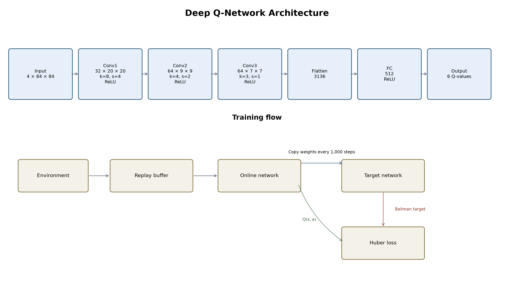
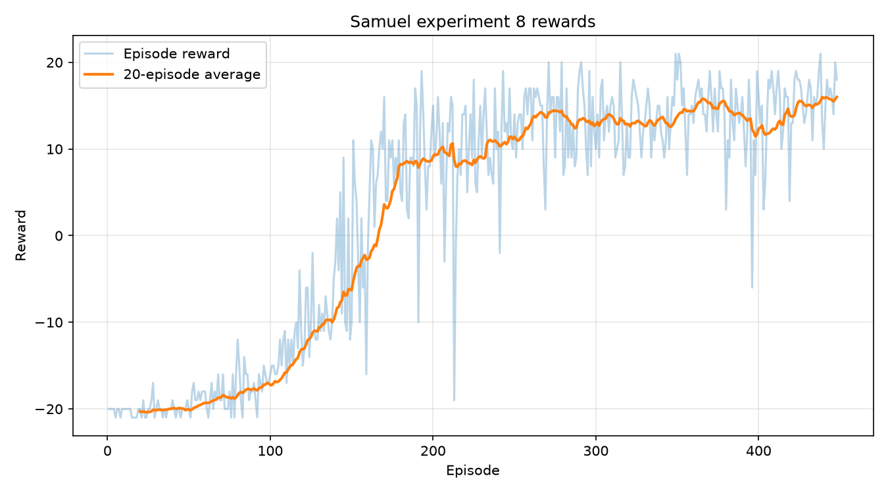
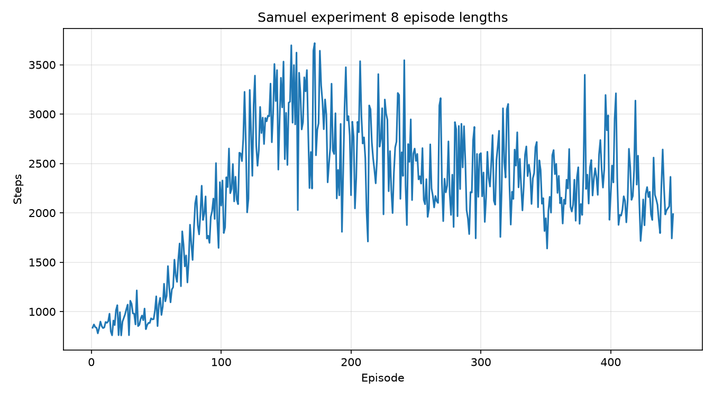
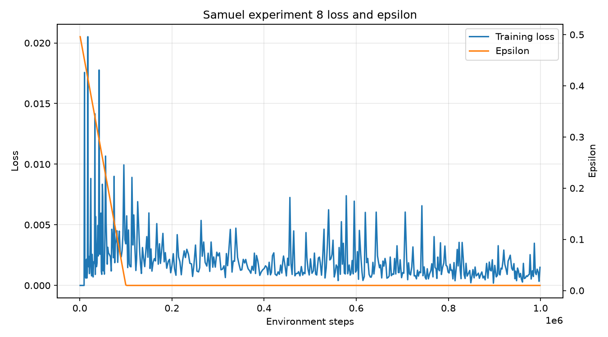
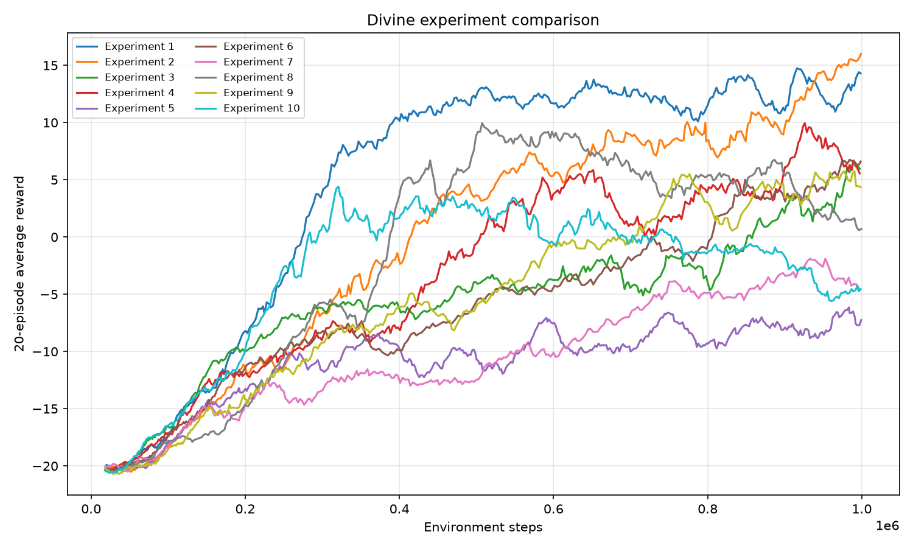
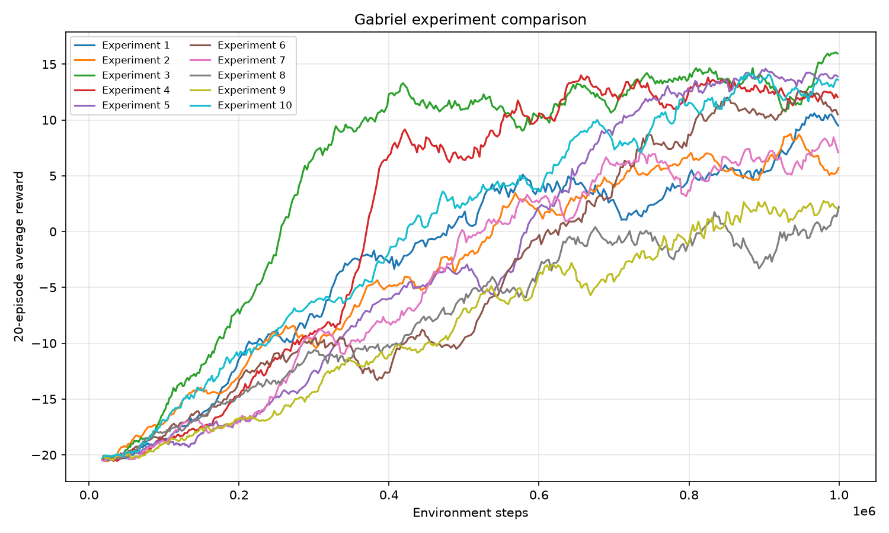
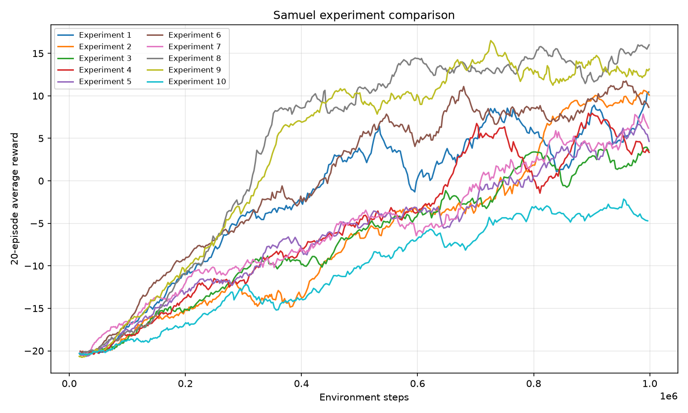

# Deep Q-Learning for Pong

## Project Introduction

We built a Deep Q-Network that learns to play Atari Pong from screen images. Divine worked on settings, the environment, the network, and this README. Gabriel worked on the replay buffer, epsilon schedule, action selection, training loop, and plots. Samuel worked on the training update, target network sync, logging, saving, and playback. Each member ran ten hyperparameter experiments.

## Group Members

- Divine
- Gabriel
- Samuel

## Selected Atari Environment

We use Pong (`ALE/Pong-v5`). The agent moves its paddle to return the ball and score more points than the opponent. The six actions are NOOP, FIRE, RIGHT, LEFT, RIGHTFIRE, and LEFTFIRE.

The environment gives a reward of -1, 0, or +1 on each step. A game's score ranges from -21 to +21. We convert each screen to grayscale at 84 by 84 pixels, skip four frames per action, allow up to 30 no-op actions at reset, and stack four frames as one observation.

## DQN Architecture

The network has five weighted layers. The layers are Conv2d 4 to 32 with output shape 32 by 20 by 20 and kernel 8, stride 4; Conv2d 32 to 64 with output 64 by 9 by 9 and kernel 4, stride 2; Conv2d 64 to 64 with output 64 by 7 by 7 and kernel 3, stride 1; Linear 3136 to 512; and Linear 512 to 6 action values. Flattening the last convolution output gives 3136 inputs to the first linear layer. ReLU follows each convolution and the 512-unit layer. The output has no activation so Q-values can be positive or negative. The CNN follows the DQN approach described by Mnih et al. [1].

All convolutional and linear weights use He initialization. It keeps signals at a useful scale in layers followed by ReLU and helped prevent dead ReLU layers [3]. The online network learns from sampled transitions. The target network supplies steadier future values and copies the online weights every 1,000 steps. A replay buffer stores 50,000 transitions and provides random batches, which reduces dependence between nearby frames. The agent chooses a random action with probability epsilon and otherwise chooses the action with the highest Q-value. Epsilon decreases linearly during training.

For each transition, the target is `reward + gamma * (1 - done) * max Q_target(next_state)`. The done mask prevents bootstrapping after a game ends. We use Huber loss, clip gradients to 10, and train with Adam using epsilon 1.5e-4, as in Rainbow [2].

## Network Architecture Diagram

## Training Process

At each step, the agent selects an action, receives the next screen and reward, and stores the transition in replay memory. After 10,000 warm-up steps, it samples a batch and updates the online network every step. Every 1,000 steps, it copies the online weights to the target network. It logs each finished episode and saves model checkpoints during and after training.

All experiments used 1,000,000 environment steps, a replay buffer of 50,000, 10,000 warm-up steps, one update per step, target sync every 1,000 steps, and seed 0. The experiments changed selected hyperparameters such as learning rate, gamma, batch size, and epsilon settings.

Some early runs stayed at -21 because ReLU layers died and produced constant Q-values for different screens. He initialization and Adam epsilon 1.5e-4 fixed this problem. The agent then learned from changing Q-values instead of remaining stuck.

## Training Results

Samuel's experiment 8 is the best run. It used learning rate 0.0001, gamma 0.99, batch size 32, epsilon start 0.5, epsilon end 0.01, and epsilon decay over 100,000 steps. Its last-100 training average was +14.60.

### Best run plots

Individual episode rewards vary, but the 20-episode average rises from about -20 to positive rewards. It stays mostly between +12 and +16 near the end of training.

Episode length grows as training begins, which means rallies last longer. Later episodes vary, but usually last around 2,000 to 2,500 steps.

Epsilon falls from 0.5 to 0.01 during the first 100,000 steps and stays there. Training loss has early spikes, then remains small with occasional increases as updates continue.

### Best and worst experiment by member

| Member | Best experiment | Last-100 average | Worst experiment | Last-100 average |
|---|---:|---:|---:|---:|
| Divine | 1 | +12.87 | 5 | -8.04 |
| Gabriel | 3 | +13.79 | 8 | -0.17 |
| Samuel | 8 | +14.60 | 10 | -4.02 |

### Member comparisons

Divine's experiments 1 and 2 finish highest in the comparison. Experiments 5, 7, and 10 remain below zero, while the other settings end between those groups.

Gabriel's experiments 3, 5, and 10 finish with the strongest moving averages. Experiment 8 ends near zero, while the other runs finish between about +1 and +14.

Samuel's experiment 8 finishes highest, with experiment 9 also reaching a high positive average. Experiment 10 ends below zero, and the remaining runs finish lower than experiment 8.

Results tables: [Divine](DivineHyperparameter_experiment_results.md), [Gabriel](GabrielHyperparameter_experiment_results.md), and [Samuel](SamuelHyperparameter_experiment_results.md).

## Gameplay Demonstration

Five greedy CPU games with Samuel experiment 8 scored +13, +16, +16, +18, and +14. The average was +15.40, and all five scores were positive.

<video controls width="480"><source src="plots/gameplay.mp4" type="video/mp4">Pong gameplay video</video>

## How to Run

Install the project dependencies with `uv sync`.

Train one experiment with `uv run train.py --member Divine --experiment 1`.

To change a hyperparameter, add an option such as `--learning_rate 0.0002`.

Play the saved model with `uv run play.py`. Make plots with `uv run plots.py`.

## References

[1] V. Mnih et al., “Human-level control through deep reinforcement learning,” *Nature*, vol. 518, pp. 529-533, 2015. [Article](https://www.nature.com/articles/nature14236).

[2] M. Hessel et al., “Rainbow: Combining Improvements in Deep Reinforcement Learning,” *Proceedings of the AAAI Conference on Artificial Intelligence*, 2018. [Paper](https://arxiv.org/abs/1710.02298).

[3] K. He, X. Zhang, S. Ren, and J. Sun, “Delving Deep into Rectifiers: Surpassing Human-Level Performance on ImageNet Classification,” *Proceedings of the IEEE International Conference on Computer Vision*, 2015. [Paper](https://arxiv.org/abs/1502.01852).
