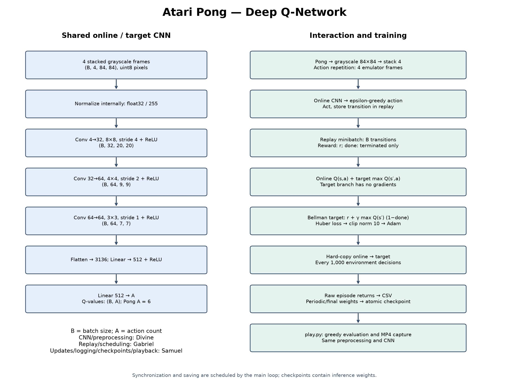
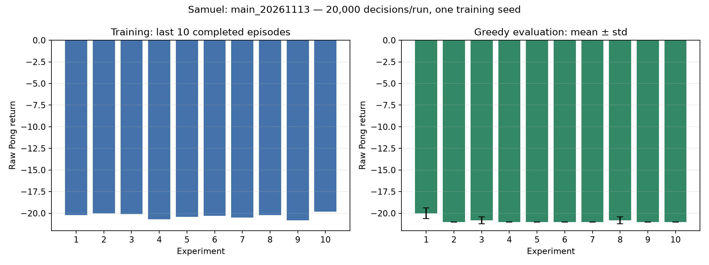

# Deep-Q-Learning

## Project Introduction

## Group Members

- Divine
- Gabriel
- Samuel

## Selected Atari Environment

## DQN Architecture

## Network Architecture Diagram



[Layer shapes and editable Mermaid diagrams](docs/Samuel_architecture.md)

## Training Process

## Training Results

[Samuel’s rerun results](SamuelHyperparameter_experiment_results.md) use the
merged `main` code. All ten pilots completed 20,000 decisions each, with five
greedy evaluation episodes per model. The highest observed mean was experiment
1: -20.00. These short, single-seed runs do not establish convergence.

New artifacts are isolated under `logs/Samuel/main_20261113/`,
`models/Samuel/main_20261113/`, and `plots/Samuel/main_20261113/`.
[Original pilot results](logs/Samuel/pilot_20261112_results.md) and its artifacts
remain preserved. The rerun explicitly uses `--train_every 4` for comparison
with that pilot; normal training from `main` defaults to every step, which was
separately integration-tested with periodic saves and a custom model path.



[Selected model training plots](plots/Samuel/main_20261113/experiment_1/training_summary.png).

## Gameplay Demonstration

[Actual rerun gameplay (MP4)](videos/Samuel/main_20261113/gameplay.mp4) —
experiment 1, greedy policy, evaluation seed 100, episode return
-21. This is a complete losing episode, approximately
56.40 seconds long. [Episode metadata](videos/Samuel/main_20261113/gameplay.json).
The model is not yet a strong Pong policy despite passing the execution checks.

Video contains one frame per four-frame action, recorded at 15 fps.

## How to Run

```bash
uv sync
uv run train.py --member Samuel --experiment 11
uv run play.py models/Samuel/main_20261113/experiment_1.pth --episodes 5
# Interactive playback (requires a display):
uv run play.py models/Samuel/main_20261113/experiment_1.pth --episodes 1 --render
# Record one complete evaluation episode:
uv run play.py models/Samuel/main_20261113/experiment_1.pth --episodes 1 --video videos/Samuel/new_gameplay.mp4
# Run ten experiments in a fresh output folder (main defaults to train_every=1):
uv run run_samuel_experiments.py --run_id full_run_01 --steps 500000
# Short comparison pilot using the previous interval of 4 decisions:
uv run run_samuel_experiments.py --run_id pilot_02 --steps 20000 --train_every 4
uv run summarize_samuel_experiments.py --run_id pilot_02 --record
# Samuel's regression checks:
uv run python -m unittest discover -s tests -v
```

Training logs refuse to overwrite an existing member/experiment CSV. Use a fresh
experiment ID or archive previous artifacts before rerunning. The experiment
runner likewise rejects existing outputs. Save and evaluation formats remain
compatible with Divine's network and Gabriel's main loop. Checkpoints contain
online weights only; logging records the latest update loss, not episode mean
loss. Partial episodes at the training budget boundary are not logged.

The single-episode plotting fix from `main` is merged and regression-tested.
Use a separate `--out_dir` for each run. For repeat experiments, use a fresh
`--run_id` so previous logs and models remain intact.
