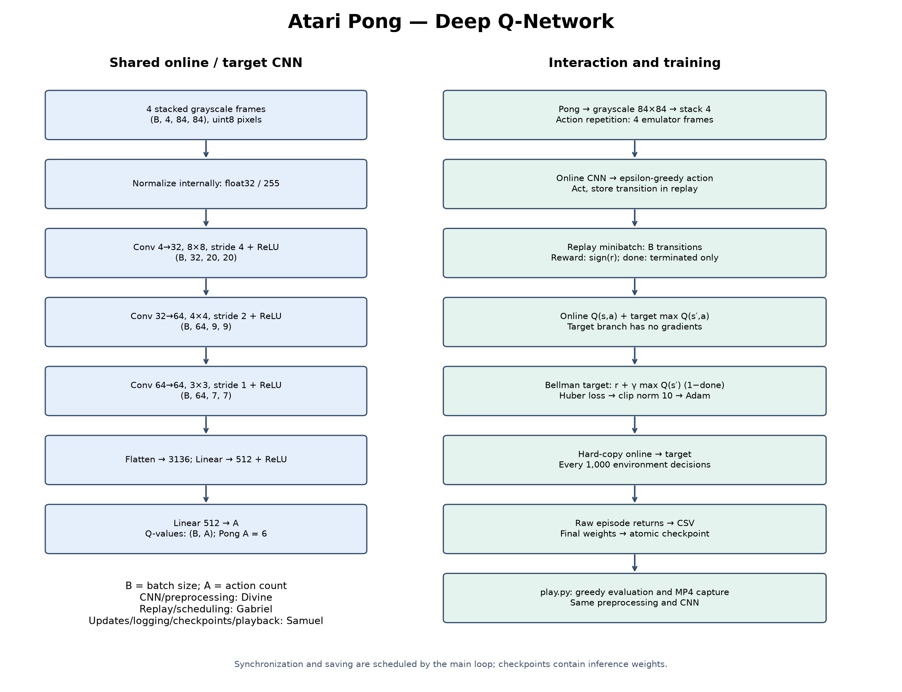
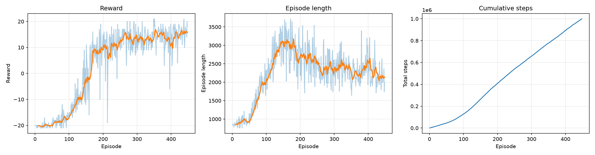

# Deep-Q-Learning

## Project Introduction

## Group Members

- Divine
- Gabriel
- Samuel

## Selected Atari Environment

## DQN Architecture

Samuel's diagram below documents Divine's shared CNN: four 84×84 grayscale
frames pass through three convolutional layers (32, 64, 64 filters), a 512-unit
dense layer and six action Q-values. Pixels are normalized inside the network.
The online and target networks have identical architecture and separate weights.

## Network Architecture Diagram



[Layer shapes and editable Mermaid diagrams](docs/Samuel_architecture.md)

## Training Process

Samuel's `train_step` consumes batches supplied by Gabriel's replay buffer.
It gathers the online value for each sampled action and computes the detached
Bellman target `reward + gamma * (1 - terminated) * max(target(next_state))`.
A Smooth L1 loss is backpropagated through the online network, gradients are
clipped to norm 10, and Adam updates its weights. True termination masks the
bootstrap; time-limit truncation does not.

The shared loop schedules target synchronization every 1,000 decisions. Samuel's
logger records raw episode return, length, cumulative decisions, epsilon and the
latest update loss. Model saving is atomic, honors `--model_path`, and supports
periodic and final saves.

The submission file `dqn_model.pth` is an exact copy of the best model from
Samuel's ten-experiment study (experiment 8,
`Samuel_outputs_notebook_batch_epsilon_01/dqn_model.pth`). It contains inference weights.

## Training Results

Samuel ran ten experiments of **1,000,000 training steps** each, varying batch size,
learning rate and starting epsilon. Lowering the starting epsilon helped most:
experiment 8 (epsilon start **0.5**) reached a last-100 training average of **+14.60**
and won 99 of its last 100 training games. On 20 independent test games (seeds
1000–1019) it scored a mean **+15.25** and won **20 of 20**, with no capped or
truncated games.

| Exp | Change from baseline | Last-100 training avg | Test (5 games) |
|---|---|---|---|
| 1 | baseline (lr 1e-4, batch 32, epsilon 1.0) | +6.39 | +10.2, 5/5 wins |
| 2 | batch 8 | +6.73 | +8.0, 4/5 |
| 3 | batch 16 | +1.87 | +10.0, 5/5 |
| 4 | batch 64 | +3.91 | +9.8, 5/5 |
| 5 | batch 128 | +3.28 | +2.6, 4/5 |
| 6 | batch 64, lr 2e-4 | +9.08 | +11.2, 5/5 |
| 7 | batch 128, lr 4e-4 | +4.40 | +10.2, 5/5 |
| **8** | **epsilon start 0.5** | **+14.60** | **+15.4, 5/5** |
| 9 | epsilon start 0.75 | +12.92 | +14.8, 5/5 |
| 10 | batch 8 + epsilon start 0.5 (best of each) | −4.02 | +0.2, 3/5 |

[Full experiment table with observed behaviour](SamuelHyperparameter_experiment_results.md).



## Gameplay Demonstration

[Experiment 8 gameplay (MP4)](Samuel_outputs_notebook_batch_epsilon_01/gameplay.mp4) —
greedy policy, seed 2000, raw return **+13**.
[Episode metadata](Samuel_outputs_notebook_batch_epsilon_01/gameplay.json).

## How to Run

Samuel's notebook workflow is [Samuel_DQN_experiments.ipynb](notebooks/Samuel_DQN_experiments.ipynb).
It follows the supplied notebook's Setup → Experiments → Save structure and
configures ten **1,000,000-step** runs focused on batch size and starting epsilon.
It includes automatic experiment-10 selection, measured result tables, training
plots, independent testing, gameplay recording and an embedded architecture diagram.
Run it locally in VS Code or Jupyter; it uses CUDA, Apple MPS or CPU automatically.
All ten runs are complete (run ID `notebook_batch_epsilon_01`); rerunning the
notebook verifies and reuses them instead of retraining.

```bash
uv sync
uv run train.py --member Samuel/new_run --experiment 1 --epsilon_start 0.5
# Presentation: canonical model, greedy actions, live game window:
uv run play.py
# Automated evaluation without a window:
uv run play.py --headless --episodes 5
# A different checkpoint can still be supplied:
uv run play.py models/Samuel/notebook_batch_epsilon_01/experiment_9.pth --render
# Record one complete evaluation episode:
uv run play.py dqn_model.pth --episodes 1 --video videos/Samuel/new_gameplay.mp4
# Samuel's regression checks:
uv run python -m unittest discover -s tests -v
```

Training logs refuse to overwrite an existing member/experiment CSV. Use a fresh
experiment ID or archive previous artifacts before rerunning. Save and evaluation formats remain
compatible with Divine's network and Gabriel's main loop. Checkpoints contain
online weights only; logging records the latest update loss, not episode mean
loss. Partial episodes at the training budget boundary are not logged.

The README video is a submission artifact. For the presentation, demonstrate
`uv run play.py` live with a display available. Playback defaults to one greedy
episode from `dqn_model.pth`; `--headless` is for automated evaluation and
`--video` selects recording automatically.

The single-episode plotting fix from `main` is merged and regression-tested.
Use a separate `--out_dir` for each run. For a new study, change `RUN_ID` in the
notebook so previous logs and models remain intact.
