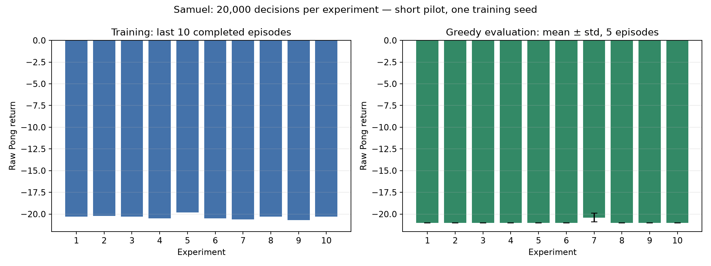

# Deep-Q-Learning

## Project Introduction

## Group Members

- Divine
- Gabriel
- Samuel

## Selected Atari Environment

## DQN Architecture

## Network Architecture Diagram


[Layer shapes and editable Mermaid diagrams](docs/Samuel_architecture.md)

## Training Process

## Training Results

[Samuel’s measured hyperparameter experiments](SamuelHyperparameter_experiment_results.md).
Each run stores CSV metrics and JSON configuration/evaluation evidence in `logs/Samuel/`.
The ten completed pilots used 20,000 decisions each and five greedy evaluation
episodes per model. Experiment 7 had the highest measured mean (-20.4); these
short runs have not produced a strong Pong policy.



[Selected model training plots](plots/Samuel/experiment_7/training_summary.png).

## Gameplay Demonstration

[Actual pilot-model gameplay (MP4)](videos/Samuel/gameplay.mp4) —
experiment 7 (highest pilot evaluation mean: -20.4), evaluation seed 100,
greedy policy, recorded episode raw return -21. This records
a complete losing episode from a short pilot, not a successful trained policy.
[Episode metadata](videos/Samuel/gameplay.json).

Record actual model gameplay with the command below. Evaluation prints raw
episode returns, termination status, and whether a step cap interrupted an episode.
Video is captured at 15 frames per second (one frame per four-frame action).

## How to Run

```bash
uv sync
uv run train.py --member Samuel --experiment 11
uv run play.py models/Samuel/experiment_1.pth --episodes 5
# Interactive playback (requires a display):
uv run play.py models/Samuel/experiment_1.pth --episodes 1 --render
# Record one complete evaluation episode:
uv run play.py models/Samuel/experiment_1.pth --episodes 1 --video videos/Samuel/gameplay.mp4
# Ten experiments after archiving existing experiment 1–10 artifacts;
# 500,000 decisions each (initial pilot used --steps 20000):
uv run run_samuel_experiments.py --steps 500000
# Samuel's regression checks:
uv run python -m unittest discover -s tests -v
```

Training logs refuse to overwrite an existing member/experiment CSV. Use a fresh
experiment ID or archive previous artifacts before rerunning. The experiment
runner likewise rejects existing outputs. Save and evaluation formats remain
compatible with Divine's network and Gabriel's main loop. Checkpoints contain
online weights only; logging records the latest update loss, not episode mean
loss. Partial episodes at the training budget boundary are not logged.

The known one-episode plotting issue in Gabriel's `plot_results.py` remains
unchanged; use a multi-episode log and a separate `--out_dir` for each run.
