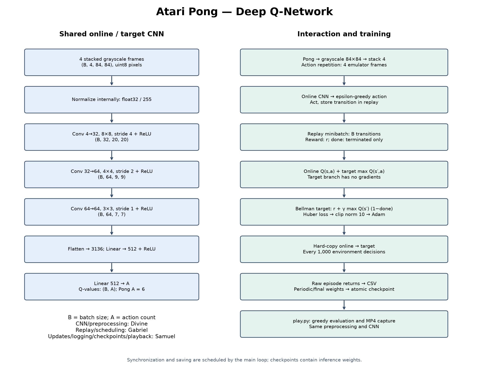
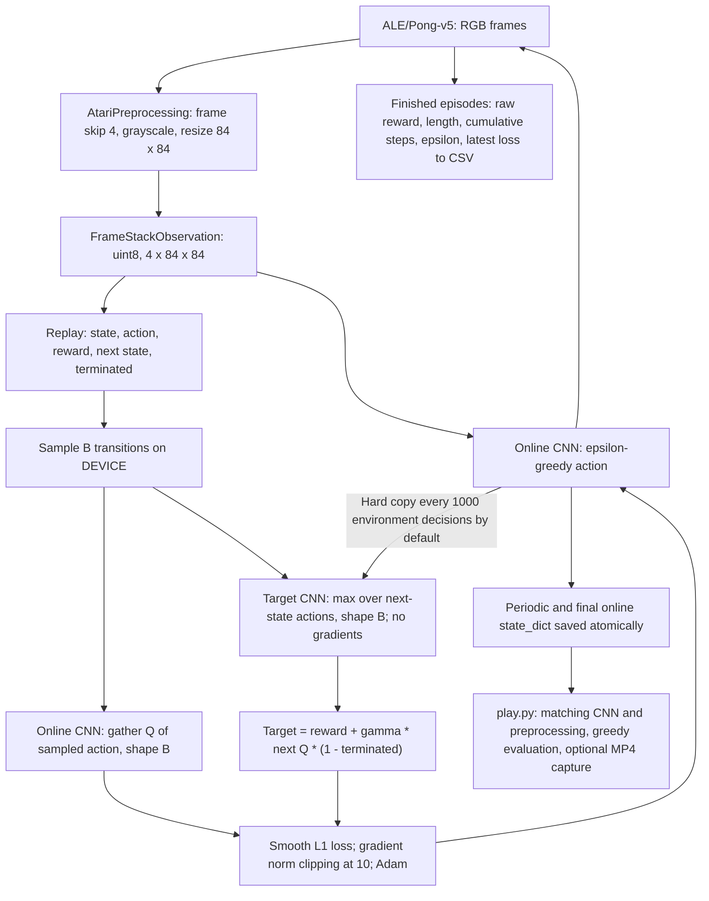
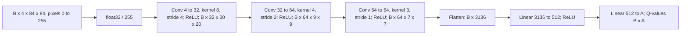

# Atari Pong DQN architecture

Regenerate PNG/SVG with `uv run python docs/draw_architecture.py`.

This diagram describes the implementation in `train.py` and `play.py`.
`B` is the minibatch size and `A` is `env.action_space.n` (six in the tested Pong setup).

## Shared CNN for online and target networks

Divine owns preprocessing and the CNN; Gabriel owns replay, exploration and
scheduling; Samuel owns gradient updates, synchronization, logging, checkpoint
saving, evaluation and recording. The training loop resets on termination or
truncation; only true termination masks the Bellman bootstrap. Replay images
must not be normalized twice. Saved weights support inference, not exact
training resumption.

## Integration with main (13 November 2026)

`ReplayBuffer.sample()` now returns uint8 images, and `train_step(online_net,
target_net, optimizer, batch, gamma)` consumes the sampled tuple directly.
The CNN now uses Kaiming initialization. The main loop uses Adam with
`eps=1.5e-4`, defaults to training every decision, and saves weights periodically
as well as at completion. `--model_path` is honored by atomic checkpoint saving.
Pong rewards are stored as supplied by the environment; no sign conversion is
applied by the current loop.
